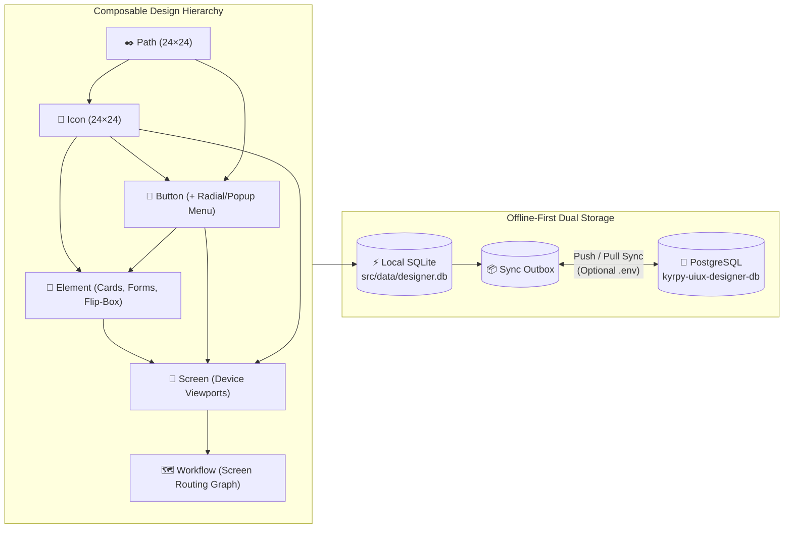

# ◈ Kyrpy UI/UX App Designer

[](./LICENSE)
[-3fb950.svg)](https://nodejs.org)
[](./sql/)
[](./src/tests/)
[](./CONTRIBUTING.md)

**Kyrpy UI/UX App Designer** is a zero-dependency, offline-first, collaborative vector & interactive UI/UX design studio built for **developers, product designers, and AI coding agents**.

Unlike traditional design tools that trap your layouts in opaque proprietary blobs or export brittle absolute-positioned divs, **Kyrpy UI/UX Designer** models every design as a composable, strictly typed hierarchy—**`Path → Icon → Button → Element → Screen → Workflow`**—backed by an isomorphic SVG/HTML/CSS/TypeScript rendering engine, live interactive runtime testing, multi-project access control, root-owner clone lineage tracking, and bi-directional **SQLite ↔ PostgreSQL** synchronization.

---

## ✨ Why Kyrpy UI/UX Designer?

- **⚡ Zero External Dependencies**: Runs out-of-the-box on **Node.js 22+** using built-in `node:sqlite`, `node:http`, `node:crypto`, and `node:test`. No `node_modules` bloat, no native compilation headaches, instant startup (`<150ms`).
- **🔌 True Offline-First Architecture**: Every action saves with `0ms` local latency to SQLite (`src/data/designer.db`). Work 100% offline on a plane or local machine, or connect a remote **PostgreSQL** server via `.env` for atomic multi-user synchronization.
- **🧱 Strict Composable Design Hierarchy**:
  - **Paths (`24×24`)**: Reusable vector path primitives with Bezier vertex editing, Boolean pathfinder ops (`unite`, `subtract`, `intersect`, `exclude`), pen tool, crop, and simplify.
  - **Icons (`24×24`)**: Composed from reusable Path groups + custom vector shapes.
  - **Buttons**: Interactive frames + icons + nested **Popup / Rotating Radial Menus** where each menu item can trigger events, route to screens, or **open any Element as a Popup / Modal Box**.
  - **Elements**: Reusable UI building blocks & 15+ interactive HTML components (forms, inputs, flip-boxes, accordions, sliders, tabs, floating toolbars, cards).
  - **Screens**: Device-framed compositions (`iPhone 15`, `iPhone 16 Pro Max`, `Pixel 8`, `Galaxy S24`, `iPad Pro`, `Desktop 1080p`, `Watch`, plus custom editable device templates).
  - **Workflows**: Visual screen-to-screen routing graphs with interactive hotspot links and live routing simulation.
- **🟢 Live "Test Actions" Simulation Mode**: Flip on **`▶ Test actions`** in any Button, Element, Screen, or Workflow designer to test real text inputs, checkboxes, toggles, sliders, CSS keyframe animations, floating toolbars, modal popups, drawers, and multi-screen navigation live on the canvas.
- **👥 Multi-Project Workspaces, RBAC/ACL & Collaborative Change Review**:
  - Public (`🌐 Public`) vs. Project-Private (`📁 Project-only`) libraries.
  - Copy or Move items across multiple projects in one click—automatically cascading all referenced sub-items (`screen → element → button → icon → path`).
  - Full **Root-Owner Lineage Tree** across multi-hop clones.
  - **Owner Approval / Rejection Workflow**: Edits by collaborators generate diff snapshots (`change_requests`) that project owners can approve or roll back in one click.

---

## 🏗 Architecture & Composable Hierarchy



---

## 🚀 One-Click Quick Start (`./install.sh`)

### Prerequisites
- **Node.js v22.5+** (uses Node's built-in `node:sqlite` — **zero** `npm install` packages required!)
- Optional: `psql` client if you want to connect to a remote PostgreSQL server.

### 1. Clone & Run the One-Click Installer

```bash
git clone https://github.com/KyrpyDev/kyrpy-uiux-designer.git
cd kyrpy-uiux-designer
./install.sh
```

### What `./install.sh` Does Automatically:
1. **Verifies Node.js v22+**.
2. **Prompts for `.env` Configuration**:
   - Asks for your preferred local HTTP port (default: `5180`).
   - Asks for optional server-side PostgreSQL credentials (`PGHOST`, `PGPORT`, `PGUSER`, `PGPASSWORD`, `PGDATABASE`).
   - **Automatic Local-Only Fallback**: If you press `Enter` to skip PostgreSQL—or if the PostgreSQL server is unreachable—the installer automatically configures **`PG_SYNC_ENABLED=false` (`LOCAL_ONLY=true`)** so the application runs **100% locally on SQLite** without any connection errors.
3. **Verifies Sample Data**: Ensures `src/data/designer.db` is loaded with the complete sample design system (`211 paths`, `206 icons`, `211 buttons`, `112 elements`, `24 screens`, `3 workflows`, `4 themes`)—or seeds it from `sql/sample_data_sqlite.sql` if missing.
4. **Launches the Server** at **`http://127.0.0.1:5180`**.

> **Non-Interactive Local Install**:
> Run `./install.sh --local-only` to skip prompts and start immediately in local SQLite mode.

---

## 🗄 Sample Database & SQL Dumps (`sql/` & `src/data/designer.db`)

This repository ships with a rich, production-grade sample UI/UX library ready to explore, remix, or use as a foundation for your own apps:

| Asset / Dump File | Description |
| :--- | :--- |
| [`src/data/designer.db`](./src/data/designer.db) | Pre-populated local SQLite database used immediately on startup (`211` paths, `206` icons, `211` buttons, `112` elements, `24` screens, `3` workflows, `4` themes, `12` device templates, `8` button templates). |
| [`sql/schema_postgres.sql`](./sql/schema_postgres.sql) | Standalone PostgreSQL DDL schema for all 21 tables (`users`, `projects`, `paths`, `icons`, `buttons`, `elements`, `screens`, `nodes`, `animations`, `menu_items`, `workflows`, `trash_items`, etc.). |
| [`sql/sample_data_postgres.sql`](./sql/sample_data_postgres.sql) | Full PostgreSQL dump (`CREATE TABLE IF NOT EXISTS` + idempotent `INSERT ... ON CONFLICT DO UPDATE`) to seed any PostgreSQL database. |
| [`sql/sample_data_sqlite.sql`](./sql/sample_data_sqlite.sql) | Full SQLite SQL dump used by `./install.sh` to reconstruct `src/data/designer.db` from scratch if deleted. |

### Importing the Sample Dump into PostgreSQL Manually
```bash
psql -h <YOUR_PGHOST> -p 5432 -U <YOUR_PGUSER> -d kyrpy-uiux-designer-db -f sql/sample_data_postgres.sql
```
Or simply configure your `.env` and click **`⇅ PG Sync → ⬆ Push Local SQLite to PostgreSQL`** inside the web UI!

---

## ⚙️ Environment Variables (`.env`)

Copy [`.env.example`](./.env.example) to `.env` (or let `./install.sh` generate it for you). **Never commit `.env` or `credentials.env`**—both are strictly protected by [`.gitignore`](./.gitignore).

```ini
# HTTP Server Port
PORT=5180

# Set PG_SYNC_ENABLED=false for 100% Local-Only SQLite mode,
# or PG_SYNC_ENABLED=true when connecting to a PostgreSQL server.
PG_SYNC_ENABLED=false
LOCAL_ONLY=true

# Optional Server-Side PostgreSQL Connection Settings (Placeholders)
PGHOST=your-postgres-host.example.com
PGPORT=5432
PGUSER=postgres
PGPASSWORD=your-postgres-password-placeholder
PGDATABASE=kyrpy-uiux-designer-db
PGADMINDB=postgres
```

### Default Local Admin Account
- **Username**: `kyrpy`
- **Password**: `kyrpy` (or `admin`)
- **Role**: `admin` (full permissions to manage users, projects, public libraries, and trash bin)

---

## 🛠 Key Features in Detail

### 1. Vector, Path & Graphic Editing Studio
- **Pen & Bezier Node Tool (`B` / `N`)**: Convert any shape to an editable path, drag control handles, toggle smooth/corner vertices (`S`/`K`), cut paths, join open endpoints, break apart subpaths, round corners, and simplify curves.
- **Boolean Pathfinder Operations**: Unite, Minus Front, Intersect, Exclude, Divide, and Crop (`X`).
- **9-Point Reference Snapping**: Instant alignment and distribution across the 9 anchor points of any canvas or selection box.
- **SVG Folder & Font Importer**: Bulk-import entire folders of `.svg` files or extract glyph vectors from `.svg` / `.ttf` fonts directly into your Paths, Icons, Buttons, or Elements libraries.

### 2. Interactive Events, Animations & Menus
- **Multi-Event Bindings**: Attach `click`, `dblclick`, `mouseover`, `mouseleave`, `release`, `drag`, `drop`, `rightclick`, `longpress`, or `focus` triggers to any element.
- **Rich Event Actions**: Route to a Screen, Open an Element inline, Open a Popup/Modal dialog, Open a Small Floating Element Toolbar, Slide in a Drawer (`left`/`right`/`top`/`bottom`), Trigger CSS Keyframe Animations (`pulse`, `bounce`, `flip`, `shake`, `swing`, `glow`, `float`, `shine`, `slide-in`), or Navigate Back.
- **Button Popup & Rotating Radial Menus**: Configure fan or list menus on any button. Each menu item supports custom icons, sub-menus up to 6 levels deep, visibility toggles (`👁`), screen routing, or **opening any Element from your library as a Popup/Modal Box**.

### 3. Multi-Project Library Management & Center-Canvas Item Browser
- **Topbar Multi-Project Selector**: Filter libraries across one or multiple projects simultaneously, switch active projects, or create new projects on the fly.
- **Center-Canvas & 90%-Wide Modal Item Browser**: Browse all 6 item types (`path`, `icon`, `button`, `element`, `screen`, `workflow`) with `Select all`, `Non select`, and `Reverse selection` tools.
- **Cascading Copy / Move to Projects**: Copy or move selected items into multiple projects as private items (`visibility: 'project'`). Moving or copying a Screen automatically copies all its sub-items (`elements → buttons → icons → paths`) into the target project.
- **Immutable Public Default Library & Trash Bin**: Default public libraries are protected from accidental emptying (`409 Conflict`). Deleted items go to the **Trash Bin (`🗑 Trash`)** first, where they can be restored or permanently purged (public items require `admin`/`superadmin`).

### 4. Full-Stack Code & Bundle Exporter
### 9. Multi-Format Library Export & Import (`HTML`, `SVG`, `JSON`)
Export and import **Paths**, **Icons**, **Buttons**, **Elements**, **Screens**, and **Workflows** directly into either **Project-Specific (`visibility: 'project'`)** or **Public (`visibility: 'public'`)** libraries in three interchangeable formats:
- **`JSON` (`.json`)**: Structured `kyrpy-uiux-library-v2` bundle with cascading sub-items (`screen → element → button → icon → path` + menu items + workflow screen bindings).
- **`SVG` (`.svg`)**: Standalone vector artwork or multi-item SVG sheet with embedded lossless library metadata (`<!-- KYRPY_UIUX_LIBRARY_PAYLOAD:... -->`) and raw `<svg>` shape parser fallback.
- **`HTML` (`.html`)**: Self-contained interactive HTML catalog previewing every exported item with inline SVGs plus an embedded `#ud-library-payload` script for lossless round-trip re-import.

### 10. Production Bundle Exporter
Export any set of screens and themes into a clean, self-contained **HTML + CSS + TypeScript + JavaScript + SVG Sprite** bundle (`DEV-NOTES.md`, `manifest.json`, `screens/*.html`, `svg/sprite.svg`, `ts/app.ts`) ready for your engineering team or AI coding agents to wire into production.

---

## 🤖 AI Agent Skill for GitHub Actions, Push, Pull, Fix & Issues

This repository ships with a built-in AI Agent Skill at [`skills/github-workflow-agent/SKILL.md`](./skills/github-workflow-agent/SKILL.md) alongside our automated GitHub Actions pipeline ([`.github/workflows/ci.yml`](./.github/workflows/ci.yml)).
AI coding assistants (Antigravity, Claude Code, Cursor, GitHub Copilot Workspace, OpenHands) can load `skills/github-workflow-agent/SKILL.md` to autonomously execute:
- **`pull`**: `git fetch origin && git pull --rebase origin main && (cd src && npm test)`
- **`push`**: Pre-push test gate (`npm test`), zero-secret audit, Conventional Commits, and `git push origin main`
- **`fix`**: Issue reproduction, regression test authoring in `src/tests/`, branch creation, and PR linking
- **`issue`**: Triage, creation, commenting, and closing via `gh issue`
- **`actions`**: Inspecting workflow runs (`gh run list`, `gh run view --log-failed`), triggering `ci.yml`, and re-running failed jobs

---

## 🗺️ Future Tasks & AI Roadmap

We are actively evolving **Kyrpy UI/UX Designer** into an AI-native collaborative design platform. Upcoming roadmap milestones include:

1. **🤝 Integrate with AI Collaboration**
   - Real-time human + multi-agent collaborative sessions on the shared canvas and workflow graph.
   - AI design co-pilots that propose layout refinements, accessibility (WCAG AAA) fixes, theme token harmonization, and interactive state wiring directly through the **Collaborative Change Request (`pending` → `approved` / `rejected`)** review pipeline.
   - Automated multi-persona UX evaluation agents that simulate user journeys across workflows and attach structured UX feedback to screens.

2. **🔌 Create an MCP (Model Context Protocol) Server**
   - Expose the entire 5-layer design hierarchy (`paths`, `icons`, `buttons`, `elements`, `screens`, `workflows`), theme tokens, and live SVG/HTML renderer as a standard **MCP Server** (`stdio` and `HTTP/SSE`).
   - Enable any MCP-compatible IDE or agent (Claude Code, Antigravity, Cursor, Windsurf, Zed) to query existing components, inspect screen layouts, create/modify vector nodes, wire screen transitions, and export production bundles via native MCP tool calls.

3. **🔑 Use BYOK (Bring Your Own Key) for Users' AI-Assisted Item Generator Features**
   - Built-in **BYOK (Bring Your Own Key)** settings vault allowing each user to configure their own API keys (OpenAI, Anthropic Claude, Google Gemini, OpenRouter, or local Ollama/vLLM endpoints) stored locally or encrypted per user profile.
   - **AI-Assisted Item Generator** across all library tiers:
     - **Paths & Icons**: Natural-language prompt to clean SVG vector path groups and Liquid-Glow icons.
     - **Buttons & Elements**: Prompt-to-component generation with automatic hover/click animations, form fields, and theme token bindings.
     - **Screens & Workflows**: Multi-screen user flow synthesis from product requirements or wireframes directly into editable hierarchical screens and connected workflow graphs.

---

## 🧪 Running Tests & Server Management

```bash
# Run the full 68-test automated suite (unit + integration + 9 adversarial user personas)
cd src && npm test

# Service management via run.sh
./run.sh start      # Start server in background on port 5180
./run.sh stop       # Stop server
./run.sh restart    # Restart server
./run.sh status     # Check PID and listening port
./run.sh health     # TCP health probe
./run.sh logs       # Stream server logs
```

---

## 🤝 Contributing — Join Us & Build the Future of Open-Source UI/UX Tooling!

We are building **Kyrpy UI/UX Designer** in the open because designers and developers deserve a fast, local-first, git-friendly, and AI-native design tool that owns its data in plain SQLite and SQL.

**Whether you love vector math, SVG rendering, UI/UX ergonomics, design tokens, or clean zero-dependency JavaScript, we would love your contributions!**

### 🌟 High-Impact Ways You Can Contribute Right Now
1. **🎨 New Built-In Themes & Surface Tokens**: Add new glassmorphic, brutalist, e-ink, or cyber-neon themes in `src/domain/theme.js`.
2. **🧩 Interactive HTML Element Templates**: Expand our library of interactive widgets (charts, data tables, date pickers, kanban cards, command palettes).
3. **📱 Device & Button Presets**: Contribute new mobile, foldable, automotive, or spatial/VR viewport templates.
4. **📦 Framework Exporters**: Help us add direct code exporters for **React / Next.js**, **Vue / Nuxt**, **Svelte**, **Flutter**, and **Dioxus (Rust)** alongside our existing HTML/TS/SVG bundle exporter in `src/application/export/`.
5. **🔌 Real-Time WebSocket / CRDT Presence**: Enhance our collaborative change-request workflow with live multi-cursor canvas presence.

### How to Submit a Pull Request
1. **Fork** the repository and create your feature branch:
   ```bash
   git checkout -b feat/amazing-ui-feature
   ```
2. **Make your changes** following our Clean Architecture boundaries:
   - `src/domain/` — Pure isomorphic domain logic (zero I/O, runs in both Node and browser).
   - `src/application/` — Use-case services & ports.
   - `src/infrastructure/` — SQLite repositories, PostgreSQL sync, SVG/Font importers, filesystem exporter.
   - `src/interfaces/` — HTTP controllers (`http/`) and vanilla ES module web studio (`web/`).
3. **Run the test suite** and make sure all tests pass:
   ```bash
   cd src && npm test
   ```
4. **Commit and open a Pull Request!** See [CONTRIBUTING.md](./CONTRIBUTING.md) for full details.

If you find this project useful, please **⭐ Star this repository** on GitHub and share it with fellow builders!

---

## 📄 License

Released under the [MIT License](./LICENSE).
