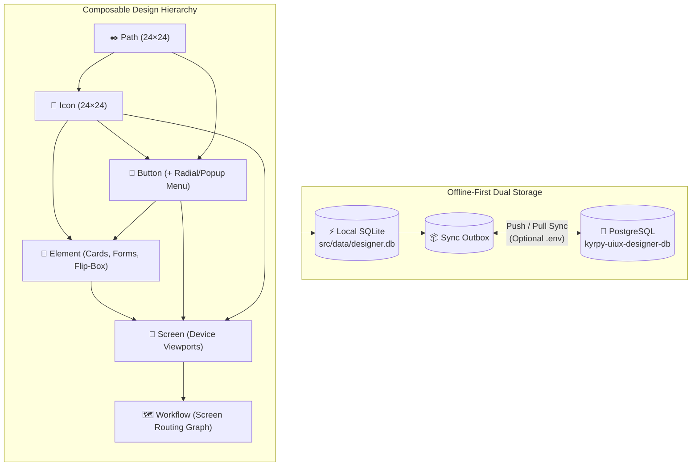

# ◈ Kyrpy UI/UX App Designer

[](./LICENSE)
[-3fb950.svg)](https://nodejs.org)
[](./sql/)
[](./src/tests/)
[](./CONTRIBUTING.md)

**Kyrpy UI/UX App Designer** is a zero-dependency, offline-first, collaborative vector & interactive UI/UX design studio built for **developers, product designers, and AI coding agents**.

Unlike traditional design tools that trap your layouts in opaque proprietary blobs or export brittle absolute-positioned divs, **Kyrpy UI/UX Designer** models every design as a composable, strictly typed hierarchy—**`Path → Icon → Button → Element → Screen → Workflow`**—backed by an isomorphic SVG/HTML/CSS/TypeScript rendering engine, live interactive runtime testing, multi-project access control, root-owner clone lineage tracking, and bi-directional **SQLite ↔ PostgreSQL** synchronization.

---

## ✨ Why Kyrpy UI/UX Designer?

- **⚡ Zero External Dependencies**: Runs out-of-the-box on **Node.js 22+** using built-in `node:sqlite`, `node:http`, `node:crypto`, and `node:test`. No `node_modules` bloat, no native compilation headaches, instant startup (`<150ms`).
- **🔌 True Offline-First Architecture**: Every action saves with `0ms` local latency to SQLite (`src/data/designer.db`). Work 100% offline on a plane or local machine, or connect a remote **PostgreSQL** server via `.env` for atomic multi-user synchronization.
- **🧱 Strict Composable Design Hierarchy**:
  - **Paths (`24×24`)**: Reusable vector path primitives with Bezier vertex editing, Boolean pathfinder ops (`unite`, `subtract`, `intersect`, `exclude`), pen tool, crop, and simplify.
  - **Icons (`24×24`)**: Composed from reusable Path groups + custom vector shapes.
  - **Buttons**: Interactive frames + icons with **per-project Button Style** (`circle` [Default], `pill`, `rounded`, `squircle`, `square`, `sharp`, `outline`, `ghost`) and **per-project Button Icon Size Slider (`50–90%`, default `70%`)** that apply across all buttons in the Buttons library, plus interactive **Radial Menu**, **Drawer Menu**, **Vertical/Horizontal Slider Menu**, **2D/3D Carousel Animated Roll Menu**, and **Show Element** actions.
  - **Elements & Containers**: Reusable UI building blocks, **Container** shells (fit-to-screen, fixed/responsive, inner/outer margins, child max-size clamping), **Carousel Containers** (2D/3D horizontal & vertical animated roll), and 15+ interactive HTML components.
  - **Screens & 15 Design Style Families (30 Dark & Light Themes)**: Device-framed compositions rendered across **15 design style families** in both **Dark and Light modes** (*Liquid Glass, Glow Lines, Neumorphic, Glassmorphism, Brutalism / Neo-Brutalism, Minimalist, Skeuomorphism, Aurora, Gradient 3D Claymorphism, Cyberpunk, Synthwave, Pastel Minimal / Cozy UI, Cosmic / Space Adventure UI, Flat Playful, Pop & Neon Retro UI*).
  - **Workflows**: Visual screen-to-screen routing graphs with interactive hotspot links and live routing simulation.
- **🟢 Live "Test Actions" Simulation Mode**: Flip on **`▶ Test actions`** in any Button, Element, Screen, or Workflow designer to test real text inputs, checkboxes, toggles, sliders, CSS keyframe animations, radial/drawer/slider/carousel menus, modal popups, drawers, and multi-screen navigation live on the canvas.
- **👥 Multi-Project Workspaces (`New`, `Save`, `Clone`, `Browse`, `Delete`), 3-Tier Scopes & Collaborative Change Review**:
  - Manage projects directly from the **Project** menu (`New Project`, `Save Project`, `Clone Project`, `Browse Projects`, `Delete Project`).
  - Three-tier visibility scopes: **🌐 Public (`public`)**, **🔒 My Global Library (`private`)**, and **📁 Project (`project`)**, plus multi-target **`Save as…`** across multiple projects at once.
  - Copy or Move items across multiple projects in one click—automatically cascading all referenced sub-items (`screen → element → button → icon → path`).
  - Full **Root-Owner Lineage Tree** across multi-hop clones.
  - **Owner Approval / Rejection Workflow**: Edits by collaborators generate diff snapshots (`change_requests`) that project owners can approve or roll back in one click.

---

## 🏗 Architecture & Composable Hierarchy



---

## 🚀 One-Click Installer & Runner (`installer.sh` / `installer.ps1` & `runner.sh` / `runner.ps1`)

### Prerequisites
- **Node.js v22.5+** (uses Node's built-in `node:sqlite` — **zero** external `npm install` packages required!)
- Optional: PostgreSQL server if you want multi-device cloud synchronization.

### 🔑 Default Accounts (published credentials)
Every fresh install and every published snapshot (`src/data/designer.db`, `sql/`) ships exactly these three accounts:

| Username | Password | Role |
|---|---|---|
| `superadmin` | `superadmin` | `superadmin` — the one account that edits / imports / updates the public library |
| `admin` | `admin` | `admin` — manages users, projects and the trash bin |
| `user` | `user` | `designer` — regular user |

> ⚠️ **These passwords are public. Change all three immediately after you clone the repository and start your own server** (profile icon → *My Profile → Password*; minimum 8 characters with a letter and a digit). While an account still has its default password, the app prompts you to change it at sign-in. Never expose a server that still uses them. (Upgrading? An old `kyrpy` account is renamed to `superadmin`; a password you set yourself is kept.)

---

### 1. Run the One-Click Installer

**Linux & macOS (`installer.sh`)**:
```bash
git clone https://github.com/KyrpyDev/kyrpy-uiux-designer.git
cd kyrpy-uiux-designer
./installer.sh
```

**Windows PowerShell (`installer.ps1`)**:
```powershell
git clone https://github.com/KyrpyDev/kyrpy-uiux-designer.git
cd kyrpy-uiux-designer
.\installer.ps1
```

#### What the One-Click Installer Does Automatically:
1. **Verifies Node.js v22+**.
2. **Prompts for Runtime Mode (`dev` vs `release`)**:
   - **`dev` mode (`APP_MODE=dev`, `BYPASS_AUTH=true`)**: Bypasses the Login/Register gate so you land directly inside the studio canvas for rapid local development.
   - **`release` mode (`APP_MODE=release`, `BYPASS_AUTH=false`)**: Protects the studio page with a full-screen **Login / Register** gate requiring authentication (e.g. `superadmin` / `superadmin`, `admin` / `admin`, `user` / `user` — change them first — or a newly registered account).
3. **Prompts for Optional `.env` PostgreSQL Credentials**:
   - Asks for your preferred local HTTP port (default: `5180`).
   - Asks if you want to configure a server-side PostgreSQL connection (`PGHOST`, `PGPORT`, `PGUSER`, `PGPASSWORD`, `PGDATABASE`, `PGADMINDB`).
   - **Automatic Local-Only Fallback**: If you skip PostgreSQL or if the server is unreachable, it automatically sets `PG_SYNC_ENABLED=false` and `LOCAL_ONLY=true` so the studio runs **100% locally on SQLite (`src/data/designer.db`)**.
4. **Seeds Default `admin` / `admin` Account & Sample Data**: Ensures `src/data/designer.db` is loaded with the sample design system (`211 paths`, `206 icons`, `211 buttons`, `114 elements`, `24 screens`, `3 workflows`, `30 themes`, `12 device templates`, `40 button templates`) and the `admin` / `admin` account.
5. **Runs Automated Verification Tests & Starts the Server** at **`http://127.0.0.1:5180`**.

> **Non-Interactive Install**:
> - Linux/macOS: `./installer.sh --non-interactive`
> - Windows PowerShell: `.\installer.ps1 -NonInteractive`

---

### 2. Using the One-Click Runner (`runner.sh` & `runner.ps1`)

After installation, use `runner.sh` (Linux/macOS) or `runner.ps1` (Windows PowerShell) to start, stop, or switch between **Dev Mode** (login bypass) and **Release Mode** (login/register protected):

**Linux & macOS (`./runner.sh`)**:
```bash
./runner.sh start     # Start studio server using mode from .env
./runner.sh dev       # Start in Dev Mode (bypasses Login/Register page)
./runner.sh release   # Start in Release Mode (protects studio with Login/Register page)
./runner.sh stop      # Stop background server
./runner.sh restart   # Restart server
./runner.sh status    # Check running PID, port, and mode
./runner.sh logs      # Stream server logs
```

**Windows PowerShell (`.\runner.ps1`)**:
```powershell
.\runner.ps1 start    # Start studio server using mode from .env
.\runner.ps1 dev      # Start in Dev Mode (bypasses Login/Register page)
.\runner.ps1 release  # Start in Release Mode (protects studio with Login/Register page)
.\runner.ps1 stop     # Stop background server
.\runner.ps1 restart  # Restart server
.\runner.ps1 status   # Check running PID and port
```

---

## 🗄 Sample Database & SQL Dumps (`sql/` & `src/data/designer.db`)

This repository ships with a rich, production-grade sample UI/UX library ready to explore, remix, or use as a foundation for your own apps:

| Asset / Dump File | Description |
| :--- | :--- |
| [`src/data/designer.db`](./src/data/designer.db) | Pre-populated local SQLite database used immediately on startup (`211` paths, `206` icons, `211` buttons, `114` elements, `24` screens, `3` workflows, `30` themes across 15 Dark/Light style families, `12` device templates, `40` button templates). |
| [`sql/schema_postgres.sql`](./sql/schema_postgres.sql) | Standalone PostgreSQL DDL schema for all 21 tables (`users`, `projects`, `paths`, `icons`, `buttons`, `elements`, `screens`, `nodes`, `animations`, `menu_items`, `workflows`, `trash_items`, etc.). |
| [`sql/sample_data_postgres.sql`](./sql/sample_data_postgres.sql) | Full PostgreSQL dump (`CREATE TABLE IF NOT EXISTS` + idempotent `INSERT ... ON CONFLICT DO NOTHING`) to seed any PostgreSQL database. |
| [`sql/sample_data_sqlite.sql`](./sql/sample_data_sqlite.sql) | Full SQLite SQL dump used by `./installer.sh` to reconstruct `src/data/designer.db` from scratch if deleted. |
| [`sql/schema_sqlite.sql`](./sql/schema_sqlite.sql) | Synchronized SQLite DDL schema for all tables and indexes. |

### Publishing the Sample Database (PostgreSQL is primary)
The files above are produced from a clone of the PostgreSQL database, never from a live SQLite file, and contain only the immutable `public` user's data:
```bash
npm --prefix src run db:publish -- --push-first --apply   # push SQLite -> PG, clone PG into publish/, leak-check, copy to src/data/designer.db and sql/
npm --prefix src run db:publish                           # dry run: only prepares the git-ignored publish/ folder
```

### Importing the Sample Dump into PostgreSQL Manually
```bash
psql -h <YOUR_PGHOST> -p 5432 -U <YOUR_PGUSER> -d kyrpy-uiux-designer-db -f sql/sample_data_postgres.sql
```
Or simply configure your `.env` and click **`⇅ PG Sync → ⬆ Push Local SQLite to PostgreSQL`** inside the web UI!

---

## ⚙️ Environment Variables (`.env`)

Copy [`.env.example`](./.env.example) to `.env` (or let `./install.sh` generate it for you). **Never commit `.env` or `credentials.env`**—both are strictly protected by [`.gitignore`](./.gitignore).

```ini
# HTTP Server Port
PORT=5180

# Set PG_SYNC_ENABLED=false for 100% Local-Only SQLite mode,
# or PG_SYNC_ENABLED=true when connecting to a PostgreSQL server.
PG_SYNC_ENABLED=false
LOCAL_ONLY=true

# Optional Server-Side PostgreSQL Connection Settings (Placeholders)
PGHOST=your-postgres-host.example.com
PGPORT=5432
PGUSER=postgres
PGPASSWORD=your-postgres-password-placeholder
PGDATABASE=kyrpy-uiux-designer-db
PGADMINDB=postgres
```

### Default Local Accounts
See **Default Accounts** above: `superadmin` / `superadmin`, `admin` / `admin`, `user` / `user`. Change the passwords right after your first start.

---

## 🛠 Key Features in Detail

### 1. Vector, Path & Graphical Editing Studio (Web Canvas + MCP `uiux_graphic_tool`)
- **Pen & Bezier Node Tool (`B` / `N`)**: Convert any shape (`rect`, `circle`, `ellipse`, `line`, `polygon`, `polyline`) to an editable Bezier `<path>`, drag control handles, edit/insert/delete vertices, toggle smooth/sharp vertices (`S`/`K`), cut paths at `(t, segment)`, join open endpoints, combine or break apart compound subpaths, reverse winding, round corners, simplify curves, and bake SVG `transform` matrices into coordinates.
- **Boolean Pathfinder & Crop Operations**: Exact polygon/curve Boolean **Union (`unite`)**, **Subtract (`minus front`)**, **Intersect**, **Exclude (`XOR`)**, **Crop to Box (`X`)**, and **Crop to Canvas**.
- **Component Explode & Reusable Extraction**: Explode placed icon instances into editable vector paths (`explode_icon`), extract `<path>` shapes into reusable `24×24` Path library items (`extract_paths_to_library`), or extract any node selection on a Screen into a reusable `Element` (`extract_as_element`).
- **9-Point Anchor Placement, Layout & Grouping**: Place child instances at any 9-point reference anchor (`top-left` … `bottom-right`), align (`left`/`center`/`right`/`top`/`middle`/`bottom`), distribute (`horizontal`/`vertical`), move, resize, proportional `fit_to_screen` (responsive container clamping), flip (`h`/`v`), rotate, group/ungroup (`<g>`), reorder layer z-order (`front`/`back`/`forward`/`backward`), duplicate in a `2×2` grid, and copy/apply fill, stroke & opacity styles.
- **SVG, Folder, Font & Online Iconify Importers**: Import inline SVG markup, entire `.svg` folders, `.svg`/`.ttf` font glyphs, or search & import open-source icon packs (Tabler, Lucide, Heroicons, Line MD, Meteocons, Devicon, Simple Icons) with preserved license attribution.

### 2. Curated Public Elements Library & Cascade Copy-to-Project
- **Rich Public Elements & Design Catalog**: Built-in public library (owned by the immutable `public` system user) shipping **114+ reusable Elements** (cards, forms, navbars, modals/popups, drawers, toolbars, responsive `container` shells, 2D/3D `carousel` containers, page-builder blocks), **211 Buttons**, **206 Icons**, **211 Paths**, **24 Screens**, **3 Workflows**, **30 Themes** across 15 Dark/Light style families, **12 Device Templates**, and **40 Button Style Templates**.
- **Use Public Elements Anywhere**: Browse, filter by category/tags, preview in any of the 30 themes, and adopt/place any public element directly onto a project Screen or Container (`uiux_public_library` + `uiux_use_public_element` in MCP, or drag/insert in the Web Studio).
- **Search & Cascade-Copy Any Item to Edit**: Search across public, private, and shared project libraries and deep-copy any `path`, `icon`, `button`, `element`, `screen`, or `workflow` into your active project (`Copy to Projects` in Web Studio or `uiux_copy_item_to_project` in MCP). Copying a Screen, Element, Button, or Workflow automatically cascades all referenced sub-items (`workflow → screen → element → button → icon → path`) into the target project with root-owner lineage preserved, so you can freely edit your project copy without mutating the source.

### 3. Interactive Events, Animations, Menus & Responsive Containers
- **Multi-Event Bindings**: Attach `click`, `dblclick`, `mouseover`, `mouseleave`, `release`, `drag`, `drop`, `rightclick`, `longpress`, or `focus` triggers to any node.
- **Rich Event Actions**: Route to a Screen (`{ type: 'screen', target }`), Open an Element inline, Open a Popup/Modal dialog, Open a Floating Element Toolbar, Slide in a Drawer (`left`/`right`/`top`/`bottom`), Trigger CSS Keyframe Animations (`pulse`, `bounce`, `flip`, `shake`, `swing`, `glow`, `float`, `shine`, `slide-in`, `fade`, `spin`), Toggle visibility, or Navigate Back.
- **Button Popup, Radial, Hub, Drawer, Slider & 2D/3D Carousel Menus**: Configure fan, list, rotating hub, drawer, vertical/horizontal slider, or 2D/3D animated carousel menus on any button, with nested sub-menus up to 6 levels deep, custom icons, screen routing, and popup element triggers.
- **Responsive Containers & Carousels**: `Container` and `Carousel` elements enforce inner/outer margins, responsive `fitNodesToScreen` viewport scaling, and child max-size clamping across mobile, tablet, and desktop viewports.

### 4. Multi-Project Library Management, Full Item CRUD & Trash Bin
- **Full CRUD Across All 6 Item Types**: Create, Read/List, Update, Soft-Delete to Trash, and Restore from Trash for `path`, `icon`, `button`, `element`, `screen`, and `workflow`—both in the Web Studio (Center-Canvas & 90%-Wide Modal Item Browser) and directly over MCP (`uiux_create_item`, `uiux_list_project_items`, `uiux_update_item`, `uiux_delete_item`).
- **Project-Scoped Keys & Per-User Trash Bin**: Keys are unique per project (`(project_id, key)`), so multiple projects can cleanly use canonical keys (`home`, `primary-btn`, `hero-card`). Deleted items are archived in a per-user **Trash Bin (`🗑 Trash`)** with full JSON + `uid` snapshots and can be restored losslessly (`restore: true`).
- **Single-Superadmin Public Governance**: Only `superadmin` mutates the public library directly; collaborator edits create reviewable `change_requests` with visual before/after diffs.

### 5. Self-Hosted Live API & MCP Documentation (`/docs/api` & `/docs/mcp`)
- **`GET /docs/api`**: Live dark/light reference generated from the canonical 168-route backend catalog (`src/interfaces/http/api-catalog.js`), showing every HTTP endpoint, `api.<action>` client method, parameters, and MCP scope eligibility, plus a live `/api/health` probe.
- **`GET /docs/mcp`**: Live reference for every registered MCP tool, resource URI, prompt, and copy-paste bearer-key setup, plus `/api/health/mcp`.

### 6. Multi-Format Library Export & Import (`HTML`, `SVG`, `JSON`)
Export and import **Paths**, **Icons**, **Buttons**, **Elements**, **Screens**, and **Workflows** directly into either **Project-Specific (`visibility: 'project'`)** or **Public (`visibility: 'public'`)** libraries in three interchangeable formats:
- **`JSON` (`.json`)**: Structured `kyrpy-uiux-library-v2` bundle with cascading sub-items (`screen → element → button → icon → path` + menu items + workflow screen bindings).
- **`SVG` (`.svg`)**: Standalone vector artwork or multi-item SVG sheet with embedded lossless library metadata (`<!-- KYRPY_UIUX_LIBRARY_PAYLOAD:... -->`) and raw `<svg>` shape parser fallback.
- **`HTML` (`.html`)**: Self-contained interactive HTML catalog previewing every exported item with inline SVGs plus an embedded `#ud-library-payload` script for lossless round-trip re-import.

### 7. Production Bundle Exporter, Native Adapters & Standalone Prototype Shell
- Export any project into a clean, self-contained **HTML + CSS + TypeScript + JavaScript + SVG Sprite** bundle (`DEV-NOTES.md`, `manifest.json`, `screens/*.html`, `svg/sprite.svg`, `ts/app.ts`, `app/interactions.json`), plus deterministic adapters for **Web**, **React TSX (`<Icon name="…"/>`)**, **Flutter (Dart)**, **Jetpack Compose (Kotlin)**, and **SwiftUI (Swift)**.
- Every exported prototype includes the dependency-free **Options Menu (`uiux/source/prototype/options-menu.js`)** to live-switch **Device viewport** (responsive / phone / tablet / laptop / desktop), **Design style** (all 30 dark/light themes), and **Button type** (`circle`, `pill`, `rounded`, `squircle`, `square`, `sharp`, `outline`, `ghost`) at runtime, plus CLI style switching via `node uiux/source/switch-style.mjs`.

---

### 8. User Profile, Sessions & Security
The profile icon (top right) opens **My Profile**: edit display name and email, change your password (minimum 8 characters with a letter and a digit; signs out other sessions), manage active sessions, and create/rotate/revoke **AI Access Keys (MCP)**. System users (`public`, `kyrpy-agent-designer`) cannot sign in or be edited.

## 🔌 MCP Server — Design ↔ Code Sync for AI Coding Agents

The designer ships an **MCP server** (Streamable HTTP, protocol 2025-06-18) so coding agents such as Claude Code, Antigravity and Cursor can use a project's design system, propose changes to it, and push the app's current UI back for human review. The implementation and developer notes are in [`src/mcp/README.md`](src/mcp/README.md).

### Connect your AI coding agent

**There is no `kyrpy-uiux` program to download or compile.** `kyrpy-uiux` is only the *name* your agent gives to this designer's MCP endpoint (`https://<your-designer-host>/mcp`, or `http://127.0.0.1:5180/mcp` locally). On your machine you need just two things:

1. **Your agent's own CLI** (only for the terminal-based clients; IDE clients such as Cursor, Windsurf, Cline or Claude Desktop are configured in their settings):

   | Client | Command | Install | Docs |
   |---|---|---|---|
   | Claude Code | `claude` | `curl -fsSL https://claude.ai/install.sh \| bash` (macOS / Linux / WSL) · `irm https://claude.ai/install.ps1 \| iex` (PowerShell) · or `npm install -g @anthropic-ai/claude-code` | [setup](https://docs.anthropic.com/en/docs/claude-code/setup) |
   | Codex CLI | `codex` | `npm install -g @openai/codex` | [openai/codex](https://github.com/openai/codex) |
   | Gemini CLI | `gemini` | `npm install -g @google/gemini-cli` | [gemini-cli](https://github.com/google-gemini/gemini-cli) |
   | opencode | `opencode` | `npm install -g opencode-ai` | [opencode.ai](https://opencode.ai/docs) |
   | VS Code (Copilot) | `code` | macOS: Command Palette ▸ *Shell Command: Install 'code' command in PATH* | [VS Code setup](https://code.visualstudio.com/docs/setup/setup-overview) |
   | Claude Desktop, Zed, any stdio client | `npx` | [Node.js 18+](https://nodejs.org) (the `mcp-remote` bridge runs through `npx`) | — |

   `npm install -g …` needs [Node.js 18+](https://nodejs.org). Check with `claude --version` (or `codex --version`, …), and open a new terminal after installing.
2. **An API key** from the designer: **Profile ▸ *AI Access Keys (MCP)…*** creates a **project key** (one project, stored per repository) or an **account key** (all your projects, stored once per user). The key is shown only once.

The *AI Access Keys* window then shows a **Connect an AI coder** panel: pick your client and shell and press **Copy all steps**. The copied text is a script you can paste straight into that shell. It:

- **checks first that your agent's CLI is installed.** If it is missing, it changes nothing and prints the install commands above.
- removes an older `kyrpy-uiux` entry that would shadow the new key (Claude Code: `local` beats `project` beats `user` scope), then adds the server and checks the connection.
- keeps config-file contents (`.mcp.json`, `settings.json`, `config.toml`) and in-app steps such as `/mcp` as **comments**. Save or merge those by hand if you want them.

What it runs for Claude Code with an account key (bash / zsh):

```bash
export KYRPY_UIUX_API_KEY='kud_live_…'            # the key from AI Access Keys
claude mcp remove kyrpy-uiux -s local 2>/dev/null || true
claude mcp remove kyrpy-uiux -s user  2>/dev/null || true
claude mcp add --transport http --scope user kyrpy-uiux https://<your-designer-host>/mcp --header "Authorization: Bearer $KYRPY_UIUX_API_KEY"
claude mcp get kyrpy-uiux                        # should say: ✔ Connected
# project key instead: run inside the repository with --scope local (and remove only the local entry)
```

Then, in the app repository, tell your agent: *"Run uiux_init …"* (the panel shows the exact sentence), or later *"pull design updates"* · *"push the existing app version"*.

**Troubleshooting**

| Symptom | Cause and fix |
|---|---|
| `mcpServers:: command not found`, `syntax error near unexpected token '}'` | A JSON config block was pasted into the shell (older copy text). Copy the steps again: config files are now comments. |
| `claude: command not found` | The Claude Code CLI is not installed. See the table above. |
| `claude mcp get` → `✘ Failed to connect … HTTP 401 … invalid, expired or revoked API key` | The entry that wins holds an old key. `claude mcp get` shows its scope. Create a new key and run the copied steps again; they remove the stale entry first. By hand: `claude mcp remove kyrpy-uiux -s local` (or `-s project` / `-s user`). |
| `direnv is not installed` | On bash / zsh / fish, project keys for opencode, Antigravity, Cursor, Windsurf, Cline, Zed and the stdio bridge use [direnv](https://direnv.net/docs/installation.html) to load the key per repository. Install it, or use an account key. |

| Area | What you get |
|---|---|
| **API keys** | Per user × project, scopes `read` / `request` / `propose`, expiry, 24 h rotation grace, instant revoke, audit log. Only an HMAC digest is stored. |
| **Account & Design keys** | User-wide **Account keys** (`read`, `request`, `propose`, `create`, plus strict `design` scope for AI-assisted design sessions with `uiux_edit_project`, `uiux_save`, `uiux_save_as` `-vNNN` milestones, `uiux_manage_versions`, `uiux_purge_versions`). On `uiux_init`, choose **download**, **clone**, **edit**, **create** (from an existing repo), or **reverse** (reverse-engineer a live Android APK / emulator or web app into hierarchical UI items & workflows). |
| **Connect any AI coder** | *AI Access Keys* generates setup for Claude Code, Codex, Gemini CLI, Antigravity, Cursor, VS Code, Windsurf, Cline, opencode, Zed, Claude Desktop and stdio bridges (bash / PowerShell / fish / cmd). Project keys stay per repository (Claude `--scope local`, `.gemini/.env`, direnv `.envrc`, VS Code input prompt), so several repos on one laptop never share a key. |
| **Public Elements & Copy-to-Project** | **`uiux_public_library`** browses/searches curated public elements, buttons, icons, paths, screens & workflows with category facets and JSON/SVG inspection; **`uiux_use_public_element`** adopts a public element (with all sub-items) into your project and optionally places it onto a Screen/Element at a 9-point anchor; **`uiux_copy_item_to_project`** searches across public, private & visible projects and cascade-copies any item into your project to edit without modifying the source. |
| **Full Direct Item CRUD & Trash** | First-class Create, Read/List, Update, Soft-Delete & Trash Restore across **all 6 item types** (`path`, `icon`, `button`, `element`, `screen`, `workflow`) via **`uiux_create_item`**, **`uiux_list_project_items`**, **`uiux_update_item`** (with `copyIfForeign: true`), and **`uiux_delete_item`** (`restore: true` restores from Trash with original `uid`). |
| **Graphical Editing Tools** | **`uiux_graphic_tool`** runs **38 pure-domain graphical & vector operations** (single step or atomic batch): primitives/containers/carousels (`add_shape`, `add_pen_path`, `place_instance`, `import_svg_nodes`), Boolean Pathfinder (`union`, `subtract`, `intersect`, `exclude`, `crop`, `crop_to_canvas`), Bezier/path ops (`convert_to_path`, `combine_paths`, `break_apart`, `join_paths`, `reverse_path`, `simplify_path`, `bake_transform`, `round_corners`, `smooth_vertices`, `sharp_vertices`, `cut_path`, `edit_vertices`), component extraction (`explode_icon`, `extract_paths_to_library`, `extract_as_element`), and layout/transform (`align`, `distribute`, `move`, `resize`, `fit_to_screen`, `flip`, `rotate`, `group`, `ungroup`, `reorder_layer`, `duplicate_nodes`, `style_nodes`, `delete_nodes`). |
| **Full Backend API Bridge** | **`uiux_api_docs`** (`uiux://api/docs`, `uiux://api/docs/{group}`) and **`uiux_api_call`** expose all allowed Designer backend API functions (`api.*` actions & `/api/*` routes) in-process—device/button templates, SVG/font/Iconify imports, nodes, animations, menus, route-crawled workflows, translations, library transfer, version snapshots, and HTML/SVG exports—even in standalone MCP mode. |
| **Read, styles & download** | Schema, manifest, ranked search, single items (JSON/SVG/HTML), tokens (JSON/CSS/TS), `uiux_import_styles` + `switch-style.mjs` + live `options-menu.js`, workflows, `uiux_check_update` / `uiux_refresh_info`, and single-use `.tar.gz` bundles with `curl → sha256sum → tar` steps. |
| **AI & Reverse-Engineer packs** | `uiux_init` installs `kyrpy-uiux-designer` + `kyrpy-skill-uiux-designer` (and optional `kyrpy-uiux-reverse-engineer` + `kyrpy-skill-uiux-reverse-engineer`) for Claude Code, Antigravity, AGENTS.md, Cursor or plain docs, plus `init-prompt.md`, `.uiux/config.json` and lockfile. Local edits are never overwritten. |
| **Adapters & Working HTML app** | `web` (tokens.css/ts, hoisted icon sprite, typed index), `react-tsx` (typed `<Icon name="…"/>`), `flutter` / `compose` / `swiftui`, and `uiux_export_app` (working HTML app + `app/interactions.json` describing every interaction, menu, workflow and developer note). |
| **Versions, Changesets & Review** | Numbered project versions (`uiux_get_manifest { sinceVersion }`, `uiux_restore_version`), live `GET /mcp` SSE notifications, reviewed changesets (`begin → stage → diff → submit`) with `baseHash` conflict detection in *Collaborate ▸ Versions & AI Changesets*, item-request queue (`uiux_request_item`), and code bindings (`uiux_bind_code`). |
| **Project scope & portable actions** | Self-contained per-project keys (`(project_id, key)`), automatic clone-on-reference for foreign/public dependencies, portable `{type, uid, key}` click/event targets, and `kyrpy-agent-designer` attribution. |
| **Security & PostgreSQL** | Origin check, 1 MB bodies, 120 calls/min and 10 bundles/h per key, 500 ops per changeset, strict tenant & public-library isolation, STRIDE review ([`src/mcp/SECURITY.md`](src/mcp/SECURITY.md)), and full MCP table parity in PostgreSQL sync. |

Full MCP user guide: [`readme-mcp.md`](./readme-mcp.md) · Architecture & milestone internals: [`src/mcp/README.md`](./src/mcp/README.md).

Run modes: embedded in `serve` at `/mcp` (disable with `MCP_MODE=off`), or standalone with `node src/main.js mcp --port 5181`.

---

## 🤖 AI Agent Skill for GitHub Actions, Push, Pull, Fix & Issues

This repository ships with a built-in AI Agent Skill at [`skills/github-workflow-agent/SKILL.md`](./skills/github-workflow-agent/SKILL.md) alongside our automated GitHub Actions pipeline ([`.github/workflows/ci.yml`](./.github/workflows/ci.yml)).
AI coding assistants (Antigravity, Claude Code, Cursor, GitHub Copilot Workspace, OpenHands) can load `skills/github-workflow-agent/SKILL.md` to autonomously execute:
- **`pull`**: `git fetch origin && git pull --rebase origin main && (cd src && npm test)`
- **`push`**: Pre-push test gate (`npm test`), zero-secret audit, Conventional Commits, and `git push origin main`
- **`fix`**: Issue reproduction, regression test authoring in `src/tests/`, branch creation, and PR linking
- **`issue`**: Triage, creation, commenting, and closing via `gh issue`
- **`actions`**: Inspecting workflow runs (`gh run list`, `gh run view --log-failed`), triggering `ci.yml`, and re-running failed jobs

---

## 🗺️ Future Tasks & AI Roadmap

We are actively evolving **Kyrpy UI/UX Designer** into an AI-native collaborative design platform. Upcoming roadmap milestones include:

1. **🤝 Integrate with AI Collaboration**
   - Real-time human + multi-agent collaborative sessions on the shared canvas and workflow graph.
   - AI design co-pilots that propose layout refinements, accessibility (WCAG AAA) fixes, theme token harmonization, and interactive state wiring directly through the **Collaborative Change Request (`pending` → `approved` / `rejected`)** review pipeline.
   - Automated multi-persona UX evaluation agents that simulate user journeys across workflows and attach structured UX feedback to screens.

2. **🔌 MCP Server — ✅ shipped** (see *MCP Server — Design ↔ Code Sync* above): versions and restore, changesets, item requests, code bindings, project/account/design keys, public elements & cascade copy-to-project, direct CRUD across all 6 item types + Trash restore, 38-operation graphical vector editing (`uiux_graphic_tool`), in-process backend API bridge (`uiux_api_docs` + `uiux_api_call`), reverse-engineering pack (`mode: "reverse"`), web/React/Flutter/Compose/SwiftUI adapters, working HTML app export, live SSE subscriptions and PostgreSQL sync for AI coding agents.

3. **🔑 Use BYOK (Bring Your Own Key) for Users' AI-Assisted Item Generator Features**
   - Built-in **BYOK (Bring Your Own Key)** settings vault allowing each user to configure their own API keys (OpenAI, Anthropic Claude, Google Gemini, OpenRouter, or local Ollama/vLLM endpoints) stored locally or encrypted per user profile.
   - **AI-Assisted Item Generator** across all library tiers:
     - **Paths & Icons**: Natural-language prompt to clean SVG vector path groups and Liquid-Glow icons.
     - **Buttons & Elements**: Prompt-to-component generation with automatic hover/click animations, form fields, and theme token bindings.
     - **Screens & Workflows**: Multi-screen user flow synthesis from product requirements or wireframes directly into editable hierarchical screens and connected workflow graphs.

---

## 🧪 Running Tests & Server Management

```bash
# Run the full automated suite (396 tests): core (unit + integration + adversarial personas) + MCP milestones M0–M10
# (the PostgreSQL round-trip test uses an isolated test database and is skipped when PG is unreachable)
cd src && npm test

# Service management via runner.sh (Linux/macOS) or runner.ps1 (Windows PowerShell)
./runner.sh start     # Start server in background on port 5180
./runner.sh dev       # Start in Dev Mode (bypasses Login/Register page)
./runner.sh release   # Start in Release Mode (protects page with Login/Register)
./runner.sh stop      # Stop server
./runner.sh restart   # Restart server
./runner.sh status    # Check PID and listening port
./runner.sh logs      # Stream server logs
```

---

## 🤝 Contributing — Join Us & Build the Future of Open-Source UI/UX Tooling!

We are building **Kyrpy UI/UX Designer** in the open because designers and developers deserve a fast, local-first, git-friendly, and AI-native design tool that owns its data in plain SQLite and SQL.

**Whether you love vector math, SVG rendering, UI/UX ergonomics, design tokens, or clean zero-dependency JavaScript, we would love your contributions!**

### 🌟 High-Impact Ways You Can Contribute Right Now
1. **🎨 New Built-In Themes & Surface Tokens**: Add new glassmorphic, brutalist, e-ink, or cyber-neon themes in `src/domain/theme.js`.
2. **🧩 Interactive HTML Element Templates**: Expand our library of interactive widgets (charts, data tables, date pickers, kanban cards, command palettes).
3. **📱 Device & Button Presets**: Contribute new mobile, foldable, automotive, or spatial/VR viewport templates.
4. **📦 Framework Exporters**: Help us add direct code exporters for **React / Next.js**, **Vue / Nuxt**, **Svelte**, **Flutter**, and **Dioxus (Rust)** alongside our existing HTML/TS/SVG bundle exporter in `src/application/export/`.
5. **🔌 Real-Time WebSocket / CRDT Presence**: Enhance our collaborative change-request workflow with live multi-cursor canvas presence.

### How to Submit a Pull Request
1. **Fork** the repository and create your feature branch:
   ```bash
   git checkout -b feat/amazing-ui-feature
   ```
2. **Make your changes** following our Clean Architecture boundaries:
   - `src/domain/` — Pure isomorphic domain logic (zero I/O, runs in both Node and browser).
   - `src/application/` — Use-case services & ports.
   - `src/infrastructure/` — SQLite repositories, PostgreSQL sync, SVG/Font importers, filesystem exporter.
   - `src/interfaces/` — HTTP controllers (`http/`) and vanilla ES module web studio (`web/`).
3. **Run the test suite** and make sure all tests pass:
   ```bash
   cd src && npm test
   ```
4. **Commit and open a Pull Request!** See [CONTRIBUTING.md](./CONTRIBUTING.md) for full details.

If you find this project useful, please **⭐ Star this repository** on GitHub and share it with fellow builders!

---

## 🙏 Acknowledgements — Open-Source Icon Sources

The library's online icon import and the bundled icon packs stand on the work of these open-source projects. Thank you to every author and contributor — please respect each set's license when you reuse its icons.

| Source | License |
|---|---|
| [Iconify API](https://iconify.design) and its [icon-set JSON](https://github.com/iconify/icon-sets) (served via jsDelivr) | MIT (API / tooling) |
| [Tabler Icons](https://github.com/tabler/tabler-icons) | MIT |
| [Lucide](https://lucide.dev) / [Lucide Animated](https://lucide-animated.com) | ISC |
| [Line MD](https://github.com/cyberalien/line-md) (Material Design line icons by Vjacheslav Trushkin) | MIT |
| [SVG Spinners](https://github.com/n3r4zzurr0/svg-spinners) | MIT |
| [Meteocons](https://meteocons.com) (Bas Milius) | MIT |
| [Devicon](https://devicon.dev) | MIT |
| [Heroicons](https://heroicons.com) / [Heroicons Animated](https://www.heroicons-animated.com) (Tailwind Labs) | MIT |
| [Simple Icons](https://simpleicons.org) | CC0 1.0 |
| [itshover](https://github.com/itshover/itshover), [Hamburger React](https://hamburger-react.netlify.app), [Moving Icons](https://www.movingicons.dev), [Animate Icons](https://animateicons.in), [AllSVGIcons](https://allsvgicons.com) | inspiration / reference sources |

Imported icons keep their per-set license in the icon metadata (`source: online/iconify`).

---

## 📄 License

Released under the [MIT License](./LICENSE).
