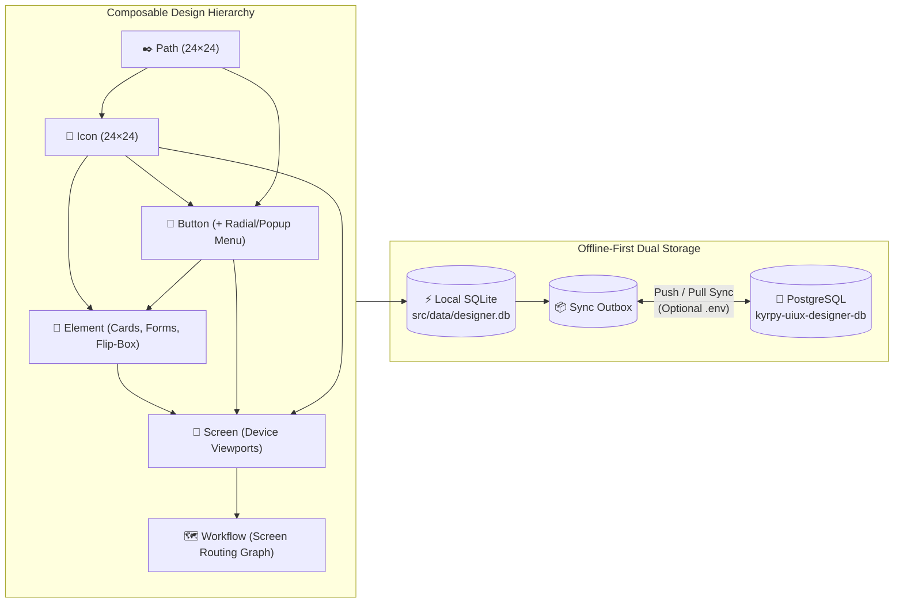

# ◈ Kyrpy UI/UX App Designer

[](./LICENSE)
[-3fb950.svg)](https://nodejs.org)
[](./sql/)
[](./src/tests/)
[](./CONTRIBUTING.md)

**Kyrpy UI/UX App Designer** is a zero-dependency, offline-first, collaborative vector & interactive UI/UX design studio built for **developers, product designers, and AI coding agents**.

Unlike traditional design tools that trap your layouts in opaque proprietary blobs or export brittle absolute-positioned divs, **Kyrpy UI/UX Designer** models every design as a composable, strictly typed hierarchy—**`Path → Icon → Button → Element → Screen → Workflow`**—backed by an isomorphic SVG/HTML/CSS/TypeScript rendering engine, live interactive runtime testing, multi-project access control, root-owner clone lineage tracking, and bi-directional **SQLite ↔ PostgreSQL** synchronization.

---

## ✨ Why Kyrpy UI/UX Designer?

- **⚡ Zero External Dependencies**: Runs out-of-the-box on **Node.js 22+** using built-in `node:sqlite`, `node:http`, `node:crypto`, and `node:test`. No `node_modules` bloat, no native compilation headaches, instant startup (`<150ms`).
- **🔌 True Offline-First Architecture**: Every action saves with `0ms` local latency to SQLite (`src/data/designer.db`). Work 100% offline on a plane or local machine, or connect a remote **PostgreSQL** server via `.env` for atomic multi-user synchronization.
- **🧱 Strict Composable Design Hierarchy**:
  - **Paths (`24×24`)**: Reusable vector path primitives with Bezier vertex editing, Boolean pathfinder ops (`unite`, `subtract`, `intersect`, `exclude`), pen tool, crop, and simplify.
  - **Icons (`24×24`)**: Composed from reusable Path groups + custom vector shapes.
  - **Buttons**: Interactive frames + icons with **per-project Button Style** (`circle` [Default], `pill`, `rounded`, `squircle`, `square`, `sharp`, `outline`, `ghost`) and **per-project Button Icon Size Slider (`50–90%`, default `70%`)** that apply across all buttons in the Buttons library, plus interactive **Radial Menu**, **Drawer Menu**, **Vertical/Horizontal Slider Menu**, **2D/3D Carousel Animated Roll Menu**, and **Show Element** actions.
  - **Elements & Containers**: Reusable UI building blocks, **Container** shells (fit-to-screen, fixed/responsive, inner/outer margins, child max-size clamping), **Carousel Containers** (2D/3D horizontal & vertical animated roll), and 15+ interactive HTML components.
  - **Screens & 15 Design Style Families (30 Dark & Light Themes)**: Device-framed compositions rendered across **15 design style families** in both **Dark and Light modes** (*Liquid Glass, Glow Lines, Neumorphic, Glassmorphism, Brutalism / Neo-Brutalism, Minimalist, Skeuomorphism, Aurora, Gradient 3D Claymorphism, Cyberpunk, Synthwave, Pastel Minimal / Cozy UI, Cosmic / Space Adventure UI, Flat Playful, Pop & Neon Retro UI*).
  - **Workflows**: Visual screen-to-screen routing graphs with interactive hotspot links and live routing simulation.
- **🟢 Live "Test Actions" Simulation Mode**: Flip on **`▶ Test actions`** in any Button, Element, Screen, or Workflow designer to test real text inputs, checkboxes, toggles, sliders, CSS keyframe animations, radial/drawer/slider/carousel menus, modal popups, drawers, and multi-screen navigation live on the canvas.
- **👥 Multi-Project Workspaces (`New`, `Save`, `Clone`, `Browse`, `Delete`), 3-Tier Scopes & Collaborative Change Review**:
  - Manage projects directly from the **Project** menu (`New Project`, `Save Project`, `Clone Project`, `Browse Projects`, `Delete Project`).
  - Three-tier visibility scopes: **🌐 Public (`public`)**, **🔒 My Global Library (`private`)**, and **📁 Project (`project`)**, plus multi-target **`Save as…`** across multiple projects at once.
  - Copy or Move items across multiple projects in one click—automatically cascading all referenced sub-items (`screen → element → button → icon → path`).
  - Full **Root-Owner Lineage Tree** across multi-hop clones.
  - **Owner Approval / Rejection Workflow**: Edits by collaborators generate diff snapshots (`change_requests`) that project owners can approve or roll back in one click.

---

## 🏗 Architecture & Composable Hierarchy



---

## 🚀 One-Click Installer & Runner (`installer.sh` / `installer.ps1` & `runner.sh` / `runner.ps1`)

### Prerequisites
- **Node.js v22.5+** (uses Node's built-in `node:sqlite` — **zero** external `npm install` packages required!)
- Optional: PostgreSQL server if you want multi-device cloud synchronization.

### 🔑 Default Startup Installer Credentials
On first boot or installation, the installer automatically seeds a default administrator account:
- **Username**: `admin`
- **Password**: `admin`
- **Role**: `superadmin` (full system & public library permissions)

---

### 1. Run the One-Click Installer

**Linux & macOS (`installer.sh`)**:
```bash
git clone https://github.com/KyrpyDev/kyrpy-uiux-designer.git
cd kyrpy-uiux-designer
./installer.sh
```

**Windows PowerShell (`installer.ps1`)**:
```powershell
git clone https://github.com/KyrpyDev/kyrpy-uiux-designer.git
cd kyrpy-uiux-designer
.\installer.ps1
```

#### What the One-Click Installer Does Automatically:
1. **Verifies Node.js v22+**.
2. **Prompts for Runtime Mode (`dev` vs `release`)**:
   - **`dev` mode (`APP_MODE=dev`, `BYPASS_AUTH=true`)**: Bypasses the Login/Register gate so you land directly inside the studio canvas for rapid local development.
   - **`release` mode (`APP_MODE=release`, `BYPASS_AUTH=false`)**: Protects the studio page with a full-screen **Login / Register** gate requiring authentication (e.g. `admin` / `admin` or a newly registered user account).
3. **Prompts for Optional `.env` PostgreSQL Credentials**:
   - Asks for your preferred local HTTP port (default: `5180`).
   - Asks if you want to configure a server-side PostgreSQL connection (`PGHOST`, `PGPORT`, `PGUSER`, `PGPASSWORD`, `PGDATABASE`, `PGADMINDB`).
   - **Automatic Local-Only Fallback**: If you skip PostgreSQL or if the server is unreachable, it automatically sets `PG_SYNC_ENABLED=false` and `LOCAL_ONLY=true` so the studio runs **100% locally on SQLite (`src/data/designer.db`)**.
4. **Seeds Default `admin` / `admin` Account & Sample Data**: Ensures `src/data/designer.db` is loaded with the sample design system (`211 paths`, `206 icons`, `211 buttons`, `114 elements`, `24 screens`, `3 workflows`, `30 themes`, `12 device templates`, `40 button templates`) and the `admin` / `admin` account.
5. **Runs Automated Verification Tests & Starts the Server** at **`http://127.0.0.1:5180`**.

> **Non-Interactive Install**:
> - Linux/macOS: `./installer.sh --non-interactive`
> - Windows PowerShell: `.\installer.ps1 -NonInteractive`

---

### 2. Using the One-Click Runner (`runner.sh` & `runner.ps1`)

After installation, use `runner.sh` (Linux/macOS) or `runner.ps1` (Windows PowerShell) to start, stop, or switch between **Dev Mode** (login bypass) and **Release Mode** (login/register protected):

**Linux & macOS (`./runner.sh`)**:
```bash
./runner.sh start     # Start studio server using mode from .env
./runner.sh dev       # Start in Dev Mode (bypasses Login/Register page)
./runner.sh release   # Start in Release Mode (protects studio with Login/Register page)
./runner.sh stop      # Stop background server
./runner.sh restart   # Restart server
./runner.sh status    # Check running PID, port, and mode
./runner.sh logs      # Stream server logs
```

**Windows PowerShell (`.\runner.ps1`)**:
```powershell
.\runner.ps1 start    # Start studio server using mode from .env
.\runner.ps1 dev      # Start in Dev Mode (bypasses Login/Register page)
.\runner.ps1 release  # Start in Release Mode (protects studio with Login/Register page)
.\runner.ps1 stop     # Stop background server
.\runner.ps1 restart  # Restart server
.\runner.ps1 status   # Check running PID and port
```

---

## 🗄 Sample Database & SQL Dumps (`sql/` & `src/data/designer.db`)

This repository ships with a rich, production-grade sample UI/UX library ready to explore, remix, or use as a foundation for your own apps:

| Asset / Dump File | Description |
| :--- | :--- |
| [`src/data/designer.db`](./src/data/designer.db) | Pre-populated local SQLite database used immediately on startup (`211` paths, `206` icons, `211` buttons, `114` elements, `24` screens, `3` workflows, `30` themes across 15 Dark/Light style families, `12` device templates, `40` button templates). |
| [`sql/schema_postgres.sql`](./sql/schema_postgres.sql) | Standalone PostgreSQL DDL schema for all 21 tables (`users`, `projects`, `paths`, `icons`, `buttons`, `elements`, `screens`, `nodes`, `animations`, `menu_items`, `workflows`, `trash_items`, etc.). |
| [`sql/sample_data_postgres.sql`](./sql/sample_data_postgres.sql) | Full PostgreSQL dump (`CREATE TABLE IF NOT EXISTS` + idempotent `INSERT ... ON CONFLICT DO NOTHING`) to seed any PostgreSQL database. |
| [`sql/sample_data_sqlite.sql`](./sql/sample_data_sqlite.sql) | Full SQLite SQL dump used by `./installer.sh` to reconstruct `src/data/designer.db` from scratch if deleted. |
| [`sql/schema_sqlite.sql`](./sql/schema_sqlite.sql) | Synchronized SQLite DDL schema for all tables and indexes. |

### Importing the Sample Dump into PostgreSQL Manually
```bash
psql -h <YOUR_PGHOST> -p 5432 -U <YOUR_PGUSER> -d kyrpy-uiux-designer-db -f sql/sample_data_postgres.sql
```
Or simply configure your `.env` and click **`⇅ PG Sync → ⬆ Push Local SQLite to PostgreSQL`** inside the web UI!

---

## ⚙️ Environment Variables (`.env`)

Copy [`.env.example`](./.env.example) to `.env` (or let `./install.sh` generate it for you). **Never commit `.env` or `credentials.env`**—both are strictly protected by [`.gitignore`](./.gitignore).

```ini
# HTTP Server Port
PORT=5180

# Set PG_SYNC_ENABLED=false for 100% Local-Only SQLite mode,
# or PG_SYNC_ENABLED=true when connecting to a PostgreSQL server.
PG_SYNC_ENABLED=false
LOCAL_ONLY=true

# Optional Server-Side PostgreSQL Connection Settings (Placeholders)
PGHOST=your-postgres-host.example.com
PGPORT=5432
PGUSER=postgres
PGPASSWORD=your-postgres-password-placeholder
PGDATABASE=kyrpy-uiux-designer-db
PGADMINDB=postgres
```

### Default Local Admin Account
- **Username**: `kyrpy`
- **Password**: `kyrpy` (or `admin`)
- **Role**: `admin` (full permissions to manage users, projects, public libraries, and trash bin)

---

## 🛠 Key Features in Detail

### 1. Vector, Path & Graphic Editing Studio
- **Pen & Bezier Node Tool (`B` / `N`)**: Convert any shape to an editable path, drag control handles, toggle smooth/corner vertices (`S`/`K`), cut paths, join open endpoints, break apart subpaths, round corners, and simplify curves.
- **Boolean Pathfinder Operations**: Unite, Minus Front, Intersect, Exclude, Divide, and Crop (`X`).
- **9-Point Reference Snapping**: Instant alignment and distribution across the 9 anchor points of any canvas or selection box.
- **SVG Folder & Font Importer**: Bulk-import entire folders of `.svg` files or extract glyph vectors from `.svg` / `.ttf` fonts directly into your Paths, Icons, Buttons, or Elements libraries.

### 2. Interactive Events, Animations & Menus
- **Multi-Event Bindings**: Attach `click`, `dblclick`, `mouseover`, `mouseleave`, `release`, `drag`, `drop`, `rightclick`, `longpress`, or `focus` triggers to any element.
- **Rich Event Actions**: Route to a Screen, Open an Element inline, Open a Popup/Modal dialog, Open a Small Floating Element Toolbar, Slide in a Drawer (`left`/`right`/`top`/`bottom`), Trigger CSS Keyframe Animations (`pulse`, `bounce`, `flip`, `shake`, `swing`, `glow`, `float`, `shine`, `slide-in`), or Navigate Back.
- **Button Popup & Rotating Radial Menus**: Configure fan or list menus on any button. Each menu item supports custom icons, sub-menus up to 6 levels deep, visibility toggles (`👁`), screen routing, or **opening any Element from your library as a Popup/Modal Box**.

### 3. Multi-Project Library Management & Center-Canvas Item Browser
- **Topbar Multi-Project Selector**: Filter libraries across one or multiple projects simultaneously, switch active projects, or create new projects on the fly.
- **Center-Canvas & 90%-Wide Modal Item Browser**: Browse all 6 item types (`path`, `icon`, `button`, `element`, `screen`, `workflow`) with `Select all`, `Non select`, and `Reverse selection` tools.
- **Cascading Copy / Move to Projects**: Copy or move selected items into multiple projects as private items (`visibility: 'project'`). Moving or copying a Screen automatically copies all its sub-items (`elements → buttons → icons → paths`) into the target project.
- **Immutable Public Default Library & Trash Bin**: Default public libraries are protected from accidental emptying (`409 Conflict`). Deleted items go to the **Trash Bin (`🗑 Trash`)** first, where they can be restored or permanently purged (public items require `admin`/`superadmin`).

### 4. Full-Stack Code & Bundle Exporter
### 9. Multi-Format Library Export & Import (`HTML`, `SVG`, `JSON`)
Export and import **Paths**, **Icons**, **Buttons**, **Elements**, **Screens**, and **Workflows** directly into either **Project-Specific (`visibility: 'project'`)** or **Public (`visibility: 'public'`)** libraries in three interchangeable formats:
- **`JSON` (`.json`)**: Structured `kyrpy-uiux-library-v2` bundle with cascading sub-items (`screen → element → button → icon → path` + menu items + workflow screen bindings).
- **`SVG` (`.svg`)**: Standalone vector artwork or multi-item SVG sheet with embedded lossless library metadata (`<!-- KYRPY_UIUX_LIBRARY_PAYLOAD:... -->`) and raw `<svg>` shape parser fallback.
- **`HTML` (`.html`)**: Self-contained interactive HTML catalog previewing every exported item with inline SVGs plus an embedded `#ud-library-payload` script for lossless round-trip re-import.

### 10. Production Bundle Exporter
Export any set of screens and themes into a clean, self-contained **HTML + CSS + TypeScript + JavaScript + SVG Sprite** bundle (`DEV-NOTES.md`, `manifest.json`, `screens/*.html`, `svg/sprite.svg`, `ts/app.ts`) ready for your engineering team or AI coding agents to wire into production.

---

### 11. User Profile, Password & Sessions
The profile icon (top right) opens **My Profile**: edit display name and email (an email change asks for the current password), change the password (minimum 8 characters with a letter and a digit, never the username or email; other sessions are signed out), list active sessions and revoke one or all others, and see your activity. System users (`public`, `kyrpy-agent-designer`) cannot sign in or be edited.

## 🔌 MCP Server — Design ↔ Code Sync for AI Coding Agents

The designer ships an **MCP server** (Streamable HTTP, protocol 2025-06-18) so coding agents such as Claude Code, Antigravity and Cursor can use a project's design system, propose changes to it, and push the app's current UI back for human review. The implementation and developer notes are in [`src/mcp/README.md`](src/mcp/README.md).

**Connect an agent** (Profile ▸ *AI Access Keys (MCP)…* creates a project key, or an account key for all your projects):

```bash
# inside the repository (project key, stored for this repo only):
claude mcp add --transport http --scope local kyrpy-uiux http://127.0.0.1:5180/mcp --header "Authorization: Bearer $KYRPY_UIUX_API_KEY"
# then, in the app repository:  "init uiux"   ·   "pull design updates"   ·   "push the existing app version"
```

| Area | What you get |
|---|---|
| **API keys** | Per user × project, scopes `read` / `request` / `propose`, expiry, 24 h rotation grace, instant revoke, audit log. Only an HMAC hash is stored. |
| **Account keys** | One user-wide key (scope `create` added) for every project you can see. On `uiux_init` the agent lists your projects **with their versions** and asks you: **clone** one into a new project of yours (build an app from it, push back as changesets), or **edit** one of your own projects at a chosen version (optional reviewed restore). Pushes only ever go to projects you own. |
| **Connect any AI coder** | *AI Access Keys* generates setup for Claude Code, Codex, Gemini CLI, Antigravity, Cursor, VS Code, Windsurf, Cline, opencode, Zed, Claude Desktop and stdio bridges (bash / PowerShell / fish / cmd). Project keys stay per repository (Claude `--scope local`, `.gemini/.env`, direnv `.envrc`, VS Code input prompt), so several repos on one laptop never share a key. |
| **Read & download** | Schema, manifest, ranked search, single items (JSON/SVG), tokens (JSON/CSS/TS), workflows, single-use `.tar.gz` bundles with `curl → sha256sum → tar` steps. |
| **AI pack** | `uiux_init` installs the `kyrpy-uiux-designer` agent and `kyrpy-skill-uiux-designer` skill for Claude Code, Antigravity, AGENTS.md, Cursor or plain docs, plus `.uiux/config.json` and a lockfile. Local edits are never overwritten. |
| **Adapters** | `web` (tokens.css/ts, icon sprite, typed index), `react-tsx` (typed `<Icon name="…"/>`), and `flutter` / `compose` / `swiftui` (native token constants, icon catalog, SVGs). |
| **Working HTML app** | `uiux_export_app` (or *Collaborate ▸ Download Project as HTML App*) packs the project as a working HTML app: every screen, workflow link, click/event action, popup, drawer and button menu works, and all images are SVG. `app/interactions.json` describes every interaction, menu, workflow and developer note in machine-readable form, so agents can inspect and re-implement the behaviour. |
| **Versions** | Numbered project versions. Designer edits and approved AI pushes each create one, and `uiux_get_manifest { sinceVersion }` returns the exact delta. **Restore** any version (*Versions ▸ Restore…* or `uiux_restore_version`). It becomes a reviewable changeset that brings deleted items back with their original uid. |
| **Live updates** | `resources/subscribe` plus a `GET /mcp` event stream: agents get `notifications/resources/updated` when a new version or an item request arrives. |
| **Changesets** | `begin → stage (validated + dry-run) → diff → submit`. Nothing changes before a human approves it. Per-item conflict detection (`baseHash`): design wins for visual attributes, code wins for bindings. |
| **Review** | *Collaborate ▸ Versions & AI Changesets* shows before/after previews and lets you approve all, approve some, or reject. AI items also appear in the Change List and the pending-changes count. |
| **Item requests** | A coding agent asks for a missing item (the server searches first). The designer agent claims it, stages the item and fulfils the request, which completes on approval. Humans can work the same queue in *AI Item Requests*. |
| **Code bindings** | Item ↔ file/symbol links. `stale` flags code that is behind the design, and re-pushing an unchanged app produces 0 operations. |
| **Project scope** | A project's design system is self-contained, and **keys are unique per project**: every public or foreign item a project uses (including click and navigation targets) is cloned into the project library under its own key. |
| **Portable interactions** | Click and event actions reference other items as `{type, uid, key}` and nodes by index. They survive cloning, syncing and pushing, and the content hash is instance-independent. |
| **AI attribution** | Every AI-applied change is made by the system user **`kyrpy-agent-designer`**, which cannot sign in. The human reviewer is recorded as the approver. |
| **Standards** | Key format, docs (`descriptionDev`, `mcpContext.purpose`), 24×24 icons, SVG sanitising, size limits, duplicates, references, hierarchy, accessibility basics. |
| **Security** | Origin check, 1 MB bodies, 120 calls/min and 10 bundles/h per key, 500 ops per changeset, tenant isolation. STRIDE review: [`src/mcp/SECURITY.md`](src/mcp/SECURITY.md). |
| **PostgreSQL** | All MCP tables (keys, audit, AI pack, versions, changesets, requests, bindings) are in the PG schema and the snapshot sync. Synced key hashes only work on instances that share `KYRPY_UIUX_KEY_PEPPER`. |

Run modes: embedded in `serve` at `/mcp` (disable with `MCP_MODE=off`), or standalone with `node src/main.js mcp --port 5181`.

---

## 🤖 AI Agent Skill for GitHub Actions, Push, Pull, Fix & Issues

This repository ships with a built-in AI Agent Skill at [`skills/github-workflow-agent/SKILL.md`](./skills/github-workflow-agent/SKILL.md) alongside our automated GitHub Actions pipeline ([`.github/workflows/ci.yml`](./.github/workflows/ci.yml)).
AI coding assistants (Antigravity, Claude Code, Cursor, GitHub Copilot Workspace, OpenHands) can load `skills/github-workflow-agent/SKILL.md` to autonomously execute:
- **`pull`**: `git fetch origin && git pull --rebase origin main && (cd src && npm test)`
- **`push`**: Pre-push test gate (`npm test`), zero-secret audit, Conventional Commits, and `git push origin main`
- **`fix`**: Issue reproduction, regression test authoring in `src/tests/`, branch creation, and PR linking
- **`issue`**: Triage, creation, commenting, and closing via `gh issue`
- **`actions`**: Inspecting workflow runs (`gh run list`, `gh run view --log-failed`), triggering `ci.yml`, and re-running failed jobs

---

## 🗺️ Future Tasks & AI Roadmap

We are actively evolving **Kyrpy UI/UX Designer** into an AI-native collaborative design platform. Upcoming roadmap milestones include:

1. **🤝 Integrate with AI Collaboration**
   - Real-time human + multi-agent collaborative sessions on the shared canvas and workflow graph.
   - AI design co-pilots that propose layout refinements, accessibility (WCAG AAA) fixes, theme token harmonization, and interactive state wiring directly through the **Collaborative Change Request (`pending` → `approved` / `rejected`)** review pipeline.
   - Automated multi-persona UX evaluation agents that simulate user journeys across workflows and attach structured UX feedback to screens.

2. **🔌 MCP Server — ✅ shipped** (see *MCP Server — Design ↔ Code Sync* above): versions and restore, changesets, item requests, code bindings, per-project keys, web/React/Flutter/Compose/SwiftUI adapters, a working HTML app export, live subscriptions and PostgreSQL sync for AI coding agents.

3. **🔑 Use BYOK (Bring Your Own Key) for Users' AI-Assisted Item Generator Features**
   - Built-in **BYOK (Bring Your Own Key)** settings vault allowing each user to configure their own API keys (OpenAI, Anthropic Claude, Google Gemini, OpenRouter, or local Ollama/vLLM endpoints) stored locally or encrypted per user profile.
   - **AI-Assisted Item Generator** across all library tiers:
     - **Paths & Icons**: Natural-language prompt to clean SVG vector path groups and Liquid-Glow icons.
     - **Buttons & Elements**: Prompt-to-component generation with automatic hover/click animations, form fields, and theme token bindings.
     - **Screens & Workflows**: Multi-screen user flow synthesis from product requirements or wireframes directly into editable hierarchical screens and connected workflow graphs.

---

## 🧪 Running Tests & Server Management

```bash
# Run the full automated suite: core (unit + integration + adversarial personas) + MCP milestones M0–M7
# (the PostgreSQL round-trip test uses an isolated test database and is skipped when PG is unreachable)
cd src && npm test

# Service management via runner.sh (Linux/macOS) or runner.ps1 (Windows PowerShell)
./runner.sh start     # Start server in background on port 5180
./runner.sh dev       # Start in Dev Mode (bypasses Login/Register page)
./runner.sh release   # Start in Release Mode (protects page with Login/Register)
./runner.sh stop      # Stop server
./runner.sh restart   # Restart server
./runner.sh status    # Check PID and listening port
./runner.sh logs      # Stream server logs
```

---

## 🤝 Contributing — Join Us & Build the Future of Open-Source UI/UX Tooling!

We are building **Kyrpy UI/UX Designer** in the open because designers and developers deserve a fast, local-first, git-friendly, and AI-native design tool that owns its data in plain SQLite and SQL.

**Whether you love vector math, SVG rendering, UI/UX ergonomics, design tokens, or clean zero-dependency JavaScript, we would love your contributions!**

### 🌟 High-Impact Ways You Can Contribute Right Now
1. **🎨 New Built-In Themes & Surface Tokens**: Add new glassmorphic, brutalist, e-ink, or cyber-neon themes in `src/domain/theme.js`.
2. **🧩 Interactive HTML Element Templates**: Expand our library of interactive widgets (charts, data tables, date pickers, kanban cards, command palettes).
3. **📱 Device & Button Presets**: Contribute new mobile, foldable, automotive, or spatial/VR viewport templates.
4. **📦 Framework Exporters**: Help us add direct code exporters for **React / Next.js**, **Vue / Nuxt**, **Svelte**, **Flutter**, and **Dioxus (Rust)** alongside our existing HTML/TS/SVG bundle exporter in `src/application/export/`.
5. **🔌 Real-Time WebSocket / CRDT Presence**: Enhance our collaborative change-request workflow with live multi-cursor canvas presence.

### How to Submit a Pull Request
1. **Fork** the repository and create your feature branch:
   ```bash
   git checkout -b feat/amazing-ui-feature
   ```
2. **Make your changes** following our Clean Architecture boundaries:
   - `src/domain/` — Pure isomorphic domain logic (zero I/O, runs in both Node and browser).
   - `src/application/` — Use-case services & ports.
   - `src/infrastructure/` — SQLite repositories, PostgreSQL sync, SVG/Font importers, filesystem exporter.
   - `src/interfaces/` — HTTP controllers (`http/`) and vanilla ES module web studio (`web/`).
3. **Run the test suite** and make sure all tests pass:
   ```bash
   cd src && npm test
   ```
4. **Commit and open a Pull Request!** See [CONTRIBUTING.md](./CONTRIBUTING.md) for full details.

If you find this project useful, please **⭐ Star this repository** on GitHub and share it with fellow builders!

---

## 📄 License

Released under the [MIT License](./LICENSE).
